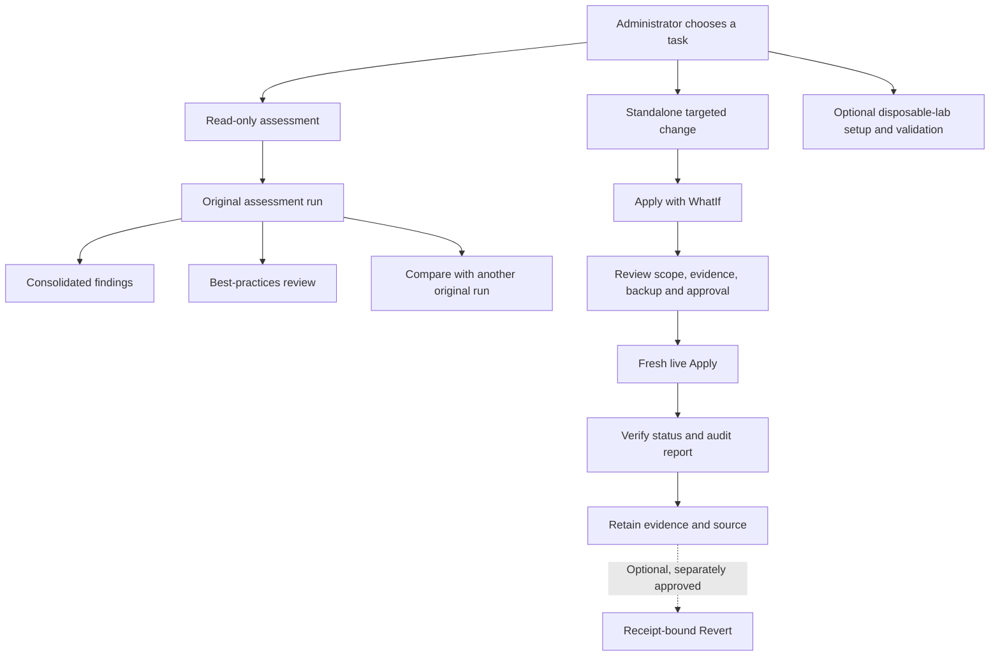
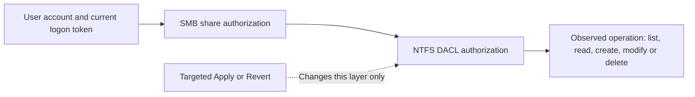
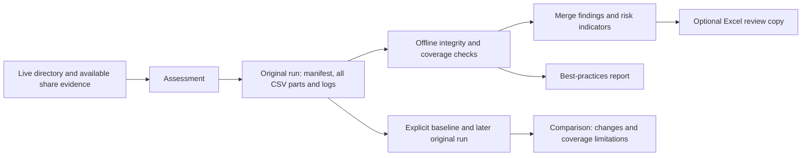
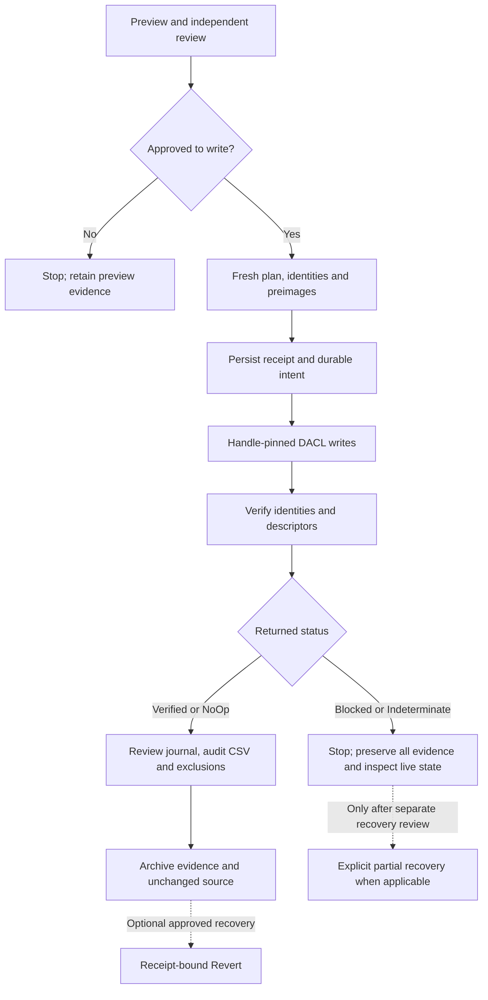
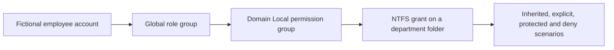
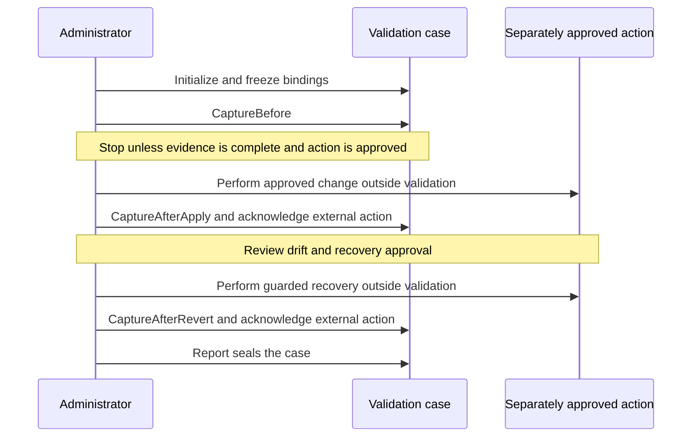

# Administrator walkthrough

A practical runbook for setting up and using the File Share Permissions Assessment
suite from a Windows administrator workstation or member file server.

**Start in an approved disposable lab.** Assessment and reporting do not change
target permissions. Direct targeted `Apply` and receipt-bound `Revert` **do change
real ACLs**, including over SMB. Availability of a command is not production
qualification, authorization, a backup, or a guarantee of effective access.
The toolkit is provided AS IS, without support or warranty, and is not an official
Microsoft product or supported Microsoft service.

## Contents

- [1. Choose a workflow](#1-choose-a-workflow)
- [2. Prepare the administrator environment](#2-prepare-the-administrator-environment)
- [3. Collect an assessment](#3-collect-an-assessment)
- [4. Review coverage and generate reports](#4-review-coverage-and-generate-reports)
- [5. Compare a later assessment](#5-compare-a-later-assessment)
- [6. Plan or preview a targeted permission change](#6-plan-or-preview-a-targeted-permission-change)
- [7. Execute and verify a targeted change](#7-execute-and-verify-a-targeted-change)
- [8. Optionally revert or review an interrupted change](#8-optionally-revert-or-review-an-interrupted-change)
- [9. Build a corporate-style disposable lab](#9-build-a-corporate-style-disposable-lab)
- [10. Collect lab test evidence](#10-collect-lab-test-evidence)
- [11. Record a separate before-and-after validation case](#11-record-a-separate-before-and-after-validation-case)
- [12. Troubleshoot and hand off](#12-troubleshoot-and-hand-off)

Examples use fictional `CONTOSO`, `FS01`, and `FILER01` names. Replace every
host, share, account, OU, path, and ticket with approved values. Paths such as
`C:\NtfsEvidence` and `D:\AssessmentRuns` are examples, not evidence that a
particular machine has suitable storage. Code blocks are checkpoints and
alternatives, **not one script to paste and execute from top to bottom**.
Diagrams use Mermaid and render in the GitHub Markdown view.

## 1. Choose a workflow

| Your task | Start here | Required earlier toolkit work | Changes target permissions? |
|---|---|---|---|
| Inventory a server, share, or subtree | `Invoke-NtfsAssessment.ps1` | None | No |
| Consolidate findings | `Merge-NtfsAssessment.ps1` | Original assessment run(s) | No |
| Create an Excel review copy | `New-NtfsExcelReview.ps1` | One completed merge report | No |
| Review settings against a policy | `New-NtfsBestPracticesReport.ps1` | One original assessment run | No |
| Compare two points in time | `Compare-NtfsAssessment.ps1` | Two original assessment runs | No |
| Review an Add proposal | `Add-FileSharePermissions.ps1 -Mode Plan` | None | No |
| Preview Add, Remove, or Replace | `Add-FileSharePermissions.ps1 -Mode Apply -WhatIf` | None | No |
| Make an approved targeted change | `Add-FileSharePermissions.ps1 -Mode Apply` | No assessment or saved plan required | **Yes** |
| Restore an earlier targeted change | `Add-FileSharePermissions.ps1 -Mode Revert` | Original receipt, reviewed hashes, evidence, and unchanged source | **Yes; optional** |
| Provision fictional users and shares | `Tests\New-NtfsLabFixture.ps1` | Approved isolated AD/file-server lab | **Yes; creates lab objects** |
| Gather test evidence | `Tests\Invoke-NtfsLabEvidence.ps1` | Approved disposable checkout for opt-in tests | Opt-in tests change their own fixtures |
| Record independent before/after observations | `Invoke-NtfsPermissionValidation.ps1` | Approved disposable target | No; external actions are separate |



There is deliberately **no required arrow from findings to Apply**. A finding
does not authorize a change, and you do not have to assess an entire file server
to replace Everyone on one approved folder. Revert and validation are optional,
separate workflows.

### Understand the permission layers

SMB share authorization, NTFS authorization, group memberships, token freshness,
deny entries, and other platform controls can all affect actual access. This
suite's targeted writer changes **NTFS DACLs**, not SMB share permissions, AD
memberships, ownership, or audit policy. Assessment inventories directory ACLs,
not individual file ACLs, and findings are not effective-access calculations.



Test actual access with approved nonadministrator allowed and negative-control
accounts. An administrator's successful read is not proof that the intended
users have access. Refresh sign-in tokens after membership changes.

## 2. Prepare the administrator environment

### 2.1 Choose the machine, session, and privileges

| Work | Where to run | Requirements |
|---|---|---|
| Live collection | Windows workstation/member server with target connectivity | PowerShell 5.1+, SMB access; SMB/CIM cmdlets and CIM authorization for Windows server discovery |
| AD enrichment or grant-group resolution | Windows with directory connectivity | RSAT `ActiveDirectory` module and AD read rights |
| Targeted changes | Approved Windows administrator host | Read/enumeration access plus DACL-write authorization on the selected scope; exclusive handles must be available |
| Offline reporting/comparison | Windows is the primary runbook environment | Complete source runs and toolkit files; no live server connection needed |
| Corporate lab provisioning | Elevated, domain-joined Windows **member file server**, not a DC | Local fixed NTFS, `SmbShare`, AD module, writable DC, and delegated AD object-creation rights |
| Test suites | Independently approved disposable Windows checkout | Pester 5.2+ when requested; local fixed NTFS for fixture suites |

Use the least-privileged authorized identity appropriate to each job. Local
elevation does not automatically grant remote share, directory, or AD rights.
Do not take ownership, weaken share security, enable remoting broadly, or
disable organizational controls to get past a refusal.

Windows PowerShell 5.1 is a suitable starting point for native Windows modules.
If using PowerShell 7, verify the required modules in that exact session and
validate that edition in your lab. Cross-platform offline/synthetic results do
not qualify Windows or NAS behavior.

```powershell
$PSVersionTable | Format-List PSVersion, PSEdition
whoami /user
Get-ExecutionPolicy -List
Get-Module -ListAvailable ActiveDirectory, SmbShare, CimCmdlets |
    Select-Object Name, Version, Path
```

Resolve missing prerequisites through your approved software/change process.
These are **alternative installation examples**, not required on machines that
already have the features:

```powershell
# Windows Server: elevated session; installs AD administration tools.
Install-WindowsFeature -Name RSAT-AD-PowerShell

# Windows client alternative: elevated session and approved feature source.
Add-WindowsCapability -Online `
    -Name 'Rsat.ActiveDirectory.DS-LDS.Tools~~~~0.0.1.0'

# Optional test dependency only; use an approved repository/package source.
Install-Module -Name Pester -MinimumVersion 5.2.0 -Scope CurrentUser
```

The suite does not install its dependencies. Pester is not required for normal
assessment, reporting, planning, or targeted changes. Do not change execution
policy to bypass an organizational requirement; obtain approved signing or an
approved execution method instead.

### 2.2 Acquire and preserve the source

Keep the top-level `.ps1` and `.cs` files together; retain `Tests` if using lab
tools. Shared scripts are loaded by entry points, not run as separate commands.
The executable implementation is PowerShell/C#; there is no separate application
installer or required ONTAP SDK.

With Git installed, acquire a checkout and select a revision your organization
has reviewed:

```powershell
git clone https://github.com/joelst/File-Share-Permissions-Assessment.git `
    C:\AdminTools\File-Share-Permissions-Assessment
Set-Location C:\AdminTools\File-Share-Permissions-Assessment

$reviewedRevision = Read-Host 'Reviewed commit or tag'
git switch --detach $reviewedRevision
if ($LASTEXITCODE -ne 0) { throw 'Could not select the reviewed source.' }
git status --short
git rev-parse HEAD
```

Alternatively, extract a reviewed source archive with the same directory
structure. Review downloaded files and hashes before following your approved
unblocking/signing process; this guide does not bypass execution policy.

Record the exact revision and any local modifications in the change record.
Archive the exact executable source used for Apply: recovery is source-bound,
and upgrading scripts can make an old receipt unusable with the new checkout.
Use a separate checkout for upgrades rather than overwriting recovery sources.

### 2.3 Separate source, target, reports, and evidence

Prepare trusted, access-restricted storage **before** the job. Restrict its
parent directories through your organization's ACL standard; do not rely on
hashes to protect sensitive evidence from rewriting.

```text
C:\AdminTools\File-Share-Permissions-Assessment\   Reviewed toolkit source
C:\NtfsEvidence\                                 Restricted permission/test evidence
D:\AssessmentRuns\                               Original assessment runs
D:\AssessmentReports\                            New offline report folders
\\FS01\AssessmentLab\Department\                  Example target; NOT output storage
```

Permission evidence must be on trusted **local fixed storage**, not an SMB or
mapped output drive, and outside the target and its backing paths. Assessment
output must also be outside all assessed trees. Independently check share
backing directories, aliases, DFS, substituted drives, reparse ancestors, and
physical mappings: a different-looking path is not proof of separation.

Use new/empty output folders where required. Do not put source, assessment
runs, reports, or a permission receipt inside the tree being changed. Plan,
preview, and validation are read-only against the **target**, but still write
local reports, evidence, locks, and evidence-directory ACLs.

### 2.4 Verify connectivity without changing access

Run only checks appropriate to the workflow:

```powershell
Resolve-DnsName FS01
Test-NetConnection -ComputerName FS01 -Port 445
Get-Acl -LiteralPath '\\FS01\AssessmentLab\Department' |
    Format-List Owner, AreAccessRulesProtected, Sddl

# For named grant groups and optional assessment enrichment:
Import-Module ActiveDirectory -ErrorAction Stop
Get-ADGroup -Identity 'Dept_Modify' -Properties GroupCategory |
    Select-Object Name, SID, GroupCategory
```

For Windows discovery using a separate CIM identity:

```powershell
$cimCredential = Get-Credential -Message 'Authorized Windows discovery account'
$cimSession = New-CimSession -ComputerName FS01 -Credential $cimCredential
try {
    Get-SmbShare -CimSession $cimSession |
        Select-Object Name, Path, EncryptData
} finally {
    Remove-CimSession -CimSession $cimSession
}
```

`-CimCredential` authenticates CIM, **not filesystem SMB access**. Filesystem
reads and writes use the running user's SMB context. Resolve DNS, time,
Kerberos/trust, logon, and firewall issues through approved procedures.
Successful root `Get-Acl` does not prove complete descendant coverage.

For NetApp or generic NAS permission work, standard Windows SMB connectivity
and Windows-style filesystem ACLs are the interface. **No ONTAP CLI or API
access is required.** `-TargetPlatform` is an operator declaration, not proof
of backend type, NTFS security style, trusted authority, or namespace identity.

## 3. Collect an assessment

### 3.1 Start with one approved subtree

This example inventories **directory** ACLs under one UNC path:

```powershell
$runRoot = 'D:\AssessmentRuns'
$assessmentTarget = '\\FS01\AssessmentLab\Department'

.\Invoke-NtfsAssessment.ps1 `
    -UncPath $assessmentTarget `
    -OutputRoot $runRoot `
    -MaxDepth 10 `
    -MaxFolders 100000 `
    -HashOutputs
$collectionExitCode = $LASTEXITCODE
```

Collection prints the actual output location. Each invocation creates a distinct
`ASSESS_<collector-host>_<timestamp>_<id>` directory; the host in its name is the
**collector**, not necessarily the target. Record that exact path. Do not select
an arbitrary newest folder in a shared output root.

Limits bound the inventory; deeper trees, inaccessible directories, reparse
points, or other errors can leave partial coverage. Raising a limit requires
capacity and scope approval, not just a desire to get an exit code of zero.

### 3.2 Choose a different collection mode when needed

These are alternatives to the preceding scan:

```powershell
# Windows server discovery: selected shares, available share ACLs and AD enrichment.
.\Invoke-NtfsAssessment.ps1 `
    -ComputerName FS01 `
    -IncludeShare 'Data', 'Projects' `
    -OutputRoot D:\AssessmentRuns `
    -ResolveActiveDirectory `
    -IncludeLocalGroups `
    -BestPractices `
    -HashOutputs

# Optional: add -CimCredential $cimCredential for CIM only.

# NAS share discovery over SMB; no ONTAP login.
.\Invoke-NtfsAssessment.ps1 `
    -NasServer FILER01 `
    -OutputRoot D:\AssessmentRuns `
    -HashOutputs
```

With no target parameters, collection defaults to the local computer. Explicit
UNC and NAS modes do not automatically provide Windows server configuration or
the same SMB share-permission coverage as Windows discovery.

When discovery is unsuitable, prepare an approved share list:

```csv
NasServer,ShareName,Enabled
FILER01,AssessmentLab,True
FILER01,OutOfScope,False
```

Save that as `C:\AdminInputs\nas-shares.csv`, then run:

```powershell
.\Invoke-NtfsAssessment.ps1 `
    -NasShareListCsv C:\AdminInputs\nas-shares.csv `
    -OutputRoot D:\AssessmentRuns `
    -HashOutputs
```

`-IncludeShare`/`-ExcludeShare` do not override mandatory exclusions, including
`ADMIN$`, `C$`, `D$`, `IPC$`, `print$`, and applicable runner-name patterns.
`-FollowReparsePoints` is intentionally rejected. `-CaptureAclBackup` and
`-UseIcaclsVerify` are optional local-Windows-share controls, not a complete
rollback solution.

If authoritative scoped ONTAP share-permission CSV evidence is already
available, `-OntapSharePermissionsCsv` can import it. It is optional and does
not establish complete share ACL coverage. Do not request ONTAP access or
fabricate rows merely to run the SMB tool. See the
[NetApp guide](NETAPP-VALIDATION.md#live-collection-commands).

## 4. Review coverage and generate reports

### 4.1 Check the original run before trusting findings

Set the path reported by your invocation:

```powershell
$baselineRun = Read-Host 'Exact baseline ASSESS run directory'
$manifest = Get-Content -LiteralPath (Join-Path $baselineRun 'manifest.json') `
    -Raw | ConvertFrom-Json
$manifest | Format-List RunId, CollectorHost, CompletedUtc, CoverageStatus, FatalError

Import-Csv -LiteralPath (Join-Path $baselineRun 'ShareCoverage.csv') |
    Format-Table Server, Share, Status, FoldersCollected, Errors, SkippedPaths
Get-Content -LiteralPath (Join-Path $baselineRun 'run.log') -Tail 30
```

Inspect `ScanErrors.csv`, `SkippedPaths.csv`, `GroupExpansion.csv`, and, when
requested, best-practices evidence errors. Record exclusions and partial scopes
in the handoff. A missing group expansion is not an empty group; an unresolved
name is not proof of a stale account. No findings is not proof of secure access.

Keep the **entire run** immutable, including its manifest and all CSV parts.
Many datasets rotate at 100,000,000 bytes per part; do not copy only the first
CSV. For a large dataset, stream all matching parts:

```powershell
Get-ChildItem -LiteralPath $baselineRun -Filter 'ScanErrors*.csv' -File |
    Sort-Object Name |
    ForEach-Object { Import-Csv -LiteralPath $_.FullName } |
    Select-Object -First 20
```

The manifest binds datasets, part files, headers, counts, sizes, and hashes.
Do not edit source CSVs to remove warnings, rename split parts, or mix files
from different runs. Recollect into a new run to address collection gaps.

### 4.2 Generate consolidated findings

Use a **new or empty** output directory outside every source run:

```powershell
$reportFolder = 'D:\AssessmentReports\Baseline-CHG-101'
.\Merge-NtfsAssessment.ps1 `
    -InputRoot $runRoot `
    -RunSelection Explicit `
    -RunFolder $baselineRun `
    -OutputFolder $reportFolder `
    -ThrottleLimit 1
$mergeExitCode = $LASTEXITCODE
```

Explicit selection is useful for a change record. To report an estate, you can
instead use `-RunSelection LatestSuccessful` without `-RunFolder`; it chooses the
newest eligible snapshot per server/share, **including partial snapshots**. It
does not fill missing permissions from older runs. `Explicit` and
`AllSuccessful` reject overlapping snapshots instead of unioning history.
Use original snapshots from disjoint scopes when selecting multiple runs.



Read these outputs in order:

| Output | Administrator question |
|---|---|
| `merge-state.json`, `merge-stage.log` | Did processing complete, and were there cleanup or processing failures? |
| `MergeSourceRuns.csv` | Did I report the intended snapshots? |
| `NTFS_QA.json`, coverage/error reports | Which limitations affect interpretation? |
| `NTFS_ExecutiveSummary.json` | What was observed at a summary level? |
| `NTFS_Findings.csv` | Which entries warrant contextual review? |
| `NTFS_RiskByFolder.csv`, `NTFS_RiskByShare.csv` | Where are the indicators concentrated? |
| `NTFS_GroupReport.csv`, `NTFS_ShareVsNtfs.csv` | Which groups and permission-layer relationships need investigation? |

Start with `-ThrottleLimit 1`: concurrent workers multiply per-share memory
use. Merge and comparison default to a 1,000,000-row-per-share guard;
increase `-MaxRowsPerShare` only with sufficient memory. An incomplete folder
ACL has no risk score and is excluded from risk averages; do not interpret a
blank score as low risk.

### 4.3 Review report data in Excel

Do not double-click a large raw CSV and assume all data loaded. CSV parts are
split at 100,000,000 bytes, but an individual part can still exceed Excel's
1,048,576-row worksheet limit. Direct opening can also infer dates and numbers
from SIDs, run IDs, leading-zero values, paths, or identity fields, and the Excel
grid cannot display a cell value longer than 32,767 characters.

As an immediate workaround, use Power Query:

1. Start with `NTFS_FindingsSummary.csv`, `NTFS_RiskByShare.csv`, coverage, and
   error reports. Only continue to `NTFS_Findings.csv`, `NTFS_RiskByFolder.csv`,
   or raw ACL data when the first reports justify it.
2. In Excel, select **Data > Get Data > From File > From Folder**, select the
   completed merge-report directory, and choose **Transform Data**.
3. Filter to one dataset schema only. For `NTFS_Findings.csv`, keep the exact
   `NTFS_Findings.csv` file and `NTFS_Findings_*.csv` parts, not
   `NTFS_FindingsSummary.csv`. Keep parts in numeric part order (`1`, `2`, `10`),
   not lexical filename order.
4. Use **Combine Files**, select **UTF-8 65001**, a **comma** delimiter, and
   **first row as headers**. Do not disable quoted multiline fields.
5. Remove an automatic **Changed Type** step or replace it with deliberate types.
   Keep SIDs, paths, identities, hashes, and run IDs as **Text**; use whole
   numbers only for counts and numeric risk columns.
6. For more than one worksheet's worth of data, use **Close & Load To > Only
   Create Connection** and enable **Add this data to the Data Model**. Use a
   PivotTable or filtered query from the model instead of loading every row to a
   grid. Use a connection-only query when long JSON/text fields are required.

Power Query reads the files; it does not update the source report. Do not save,
retype, or fill data into the original CSVs. Their `NTFS_QA.json` inventory
records part sizes, row counts, headers, and SHA-256 hashes.

For a repeatable workbook, generate an optional `.xlsx` from the completed merge
report:

```powershell
$reviewWorkbook = 'D:\AssessmentExports\Baseline-CHG-101-Review.xlsx'
.\New-NtfsExcelReview.ps1 `
    -InputReportFolder $reportFolder `
    -OutputPath $reviewWorkbook
```

The exporter requires a completed or completed-with-warnings merge, validates
the selected CSV parts against `NTFS_QA.json`, and writes to a new output outside
the source report. It needs no Excel application or `ImportExcel` module. The
default workbook includes the review reports but excludes raw `NTFS_AllAces.csv`
and `NTFS_Folders.csv` data. It stores identifiers and formula-like source values
as Excel text, freezes headers, enables filters, and splits large datasets into
numbered worksheets without silently truncating them. For evidence integrity,
neither the source report nor the output path can traverse a symlink or other
reparse point. On Windows, use direct fixed drive-letter paths such as
`D:\AssessmentReports\Baseline` and `D:\AssessmentExports`; the exporter refuses
UNC, mapped-drive, device-prefix, short-name, and mounted-folder aliases because
those namespaces cannot be proven outside the source report without operator
mapping evidence. Its PowerShell 7 cross-platform path is for synthetic/offline
testing, not Windows or SMB production qualification.

```powershell
# Add raw folder and ACE inventories to the standard review sheets.
.\New-NtfsExcelReview.ps1 `
    -InputReportFolder $reportFolder `
    -OutputPath D:\AssessmentExports\Baseline-CHG-101-WithRaw.xlsx `
    -IncludeRawData

# Replace the default dataset set with only the requested reports.
.\New-NtfsExcelReview.ps1 `
    -InputReportFolder $reportFolder `
    -OutputPath D:\AssessmentExports\Baseline-CHG-101-Findings.xlsx `
    -Dataset NTFS_Findings.csv,NTFS_RiskByShare.csv
```

Review the workbook's `Overview` sheet first; it carries merge warnings,
limitations, selected source-run paths, and the integrity-checked datasets.
The workbook is a convenience copy. It does not replace the original report,
prove effective access, or authorize remediation. Selected JSON and CSV inputs
are opened through pinned handles and the workbook uses the exact CSV bytes
that were hashed. On Windows, directory routes and the pending workbook remain
pinned through publication; path checks are not a substitute for those handles.
If a source cell exceeds Excel's 32,767-character text limit, the exporter fails
instead of truncating it; use Power Query's connection/Data Model workflow or a
filtered source export for that field.

### 4.4 Generate a best-practices report

If required settings were collected, generate a separate offline report:

```powershell
.\New-NtfsBestPracticesReport.ps1 `
    -InputRunFolder $baselineRun `
    -OutputFolder D:\AssessmentReports\Baseline-CHG-101-BestPractices
```

Review `BestPracticeChecks.csv`, `BestPracticeSummary.json`,
`BestPracticesManifest.json`, and `report.log`.

The built-in review baseline expects SMB1 off, signing required, share encryption
and access-based enumeration enabled, and no direct-user or broad-principal
write-capable allow entries. These are review expectations, not an official
compliance baseline or automatic remediation instructions. ABE controls
visibility, not access authorization.

For an approved exception, create a policy file outside source runs:

```json
{
  "schemaVersion": 1,
  "rules": [
    { "checkId": "ShareEncryptionEnabled", "expectedValue": false }
  ]
}
```

```powershell
.\New-NtfsBestPracticesReport.ps1 `
    -InputRunFolder $baselineRun `
    -OutputFolder D:\AssessmentReports\Baseline-CHG-101-ApprovedPolicy `
    -BestPracticesPolicyPath C:\AdminInputs\approved-policy.json
```

Only listed expectations are overridden; omitted checks retain the built-in
baseline. Pass the approved policy explicitly to offline reporting: it does
not automatically reuse a collection-time custom policy.

If you need live audit/settings evidence missing from the run, recollect with
the appropriate Windows mode and `-BestPractices`; add `-CollectAuditEvidence`
only when separately authorized. Audit policy is collected locally only;
root SACL samples do not establish descendant SACL coverage. Offline reporting
cannot fill these gaps. `NotAssessed` is not a pass; a policy match applies only
to the observed setting, not overall compliance.

## 5. Compare a later assessment

After an approved external change or normal observation interval, repeat the
same collection command with matching addressing, targets, filters, and limits.
Capture the actual new run path:

```powershell
.\Invoke-NtfsAssessment.ps1 `
    -UncPath $assessmentTarget `
    -OutputRoot $runRoot `
    -MaxDepth 10 `
    -MaxFolders 100000 `
    -HashOutputs

$comparisonRun = Read-Host 'Exact later ASSESS run directory'
.\Compare-NtfsAssessment.ps1 `
    -BaselineRunFolder $baselineRun `
    -ComparisonRunFolder $comparisonRun `
    -OutputFolder D:\AssessmentReports\Changes-CHG-101
$comparisonExitCode = $LASTEXITCODE
```

Supply **original assessment runs, not merged reports**. Avoid the automatic
two-newest selection when unrelated administrators or targets share the run
root. Do not mix local and UNC addressing for the same share across snapshots.

Review `comparison-state.json`, `comparison-stage.log`,
`NTFS_ComparisonRuns.csv`, `NTFS_ComparisonSummary.json`,
`NTFS_ComparisonCoverage.csv`, and `NTFS_Changes.csv`.

An altered ACE can appear as Removed plus Added. Missing records can mean
missing coverage, not deletion or revoked access. Individual file ACLs, group
membership changes, and effective access are not compared. Exit `0` can include
differences; exit `1` means limitations/warnings need review.

## 6. Plan or preview a targeted permission change

**This is an independent entry point.** No baseline, merge report, validation
case, or earlier plan is required. Start here after setup if the task is a
specific approved folder-level change.

### 6.1 Select the target, operation, and scope

Use canonical direct paths when possible:

| Target | Example | Platform declaration |
|---|---|---|
| Local fixed Windows NTFS | `D:\DisposableLab\Department` | `Windows` |
| Windows SMB | `\\FS01\AssessmentLab\Department` | `Windows` |
| NetApp ONTAP / Azure NetApp Files SMB | `\\FILER01\AssessmentLab\Department` | `NetApp` |
| Generic NAS SMB | `\\NAS01\AssessmentLab\Department` | `Nas` or `Auto` |
| Existing mapped SMB drive | `Z:\Department` | Actual declared backend; mapping freezes to UNC |

An elevated session may not have the same drive mappings as a normal session.
Use direct UNC if the mapping is unavailable; do not guess a new mapping.
`Auto` does not infer NetApp from a hostname. Client AD resolution does not
prove backend trust or target authority. Machine-local and SVM-local groups
are unsupported for grants.

| Choice | Behavior and review requirement |
|---|---|
| `Add` | Add requested allow coverage without intentionally removing other grants. |
| `Remove` | Remove matching source allow ACEs; supply `-RemovePrincipal` and no replacement grant options. |
| `Replace` | Remove source allow ACEs and insert requested group grants at those entries, retaining source inheritance/propagation flags. |
| `ThisFolderSubfoldersAndFiles` | Process selected nonprotected descendants; review exclusions and the full audit. |
| `ThisFolderOnly` | Do not assume effective access to children is unchanged; parent rights can authorize child operations. Inheritable source removal is refused. |

Use exact permission labels `Read`, `ReadAndExecute`, `Modify`, or `FullControl`
for grant input. `Modify` and `FullControl` include deletion capabilities.
Replacement rights may be **broader** than the source rights, and existing
destination rights are not reduced.

Protected branches are not modified; review `ExcludedPathCount`, which counts
excluded objects rather than only branch roots. Matching source deny ACEs,
inherited source ACEs defined above the target, unsupported descriptors,
unreadable paths, reparse/hard-link boundaries, or unavailable exclusive handles
can block the change. The tool does not silently break inheritance or delete
deny ACEs.

### 6.2 Optional review-only Add plan

```powershell
$plan = .\Add-FileSharePermissions.ps1 `
    -Mode Plan `
    -TargetPath '\\FS01\AssessmentLab\Department' `
    -TargetPlatform Windows `
    -GroupName 'CONTOSO\Dept_Read' `
    -Permissions ReadAndExecute `
    -Scope ThisFolderSubfoldersAndFiles `
    -MaxPaths 10000 `
    -OutputDirectory C:\NtfsEvidence

$plan | Format-List Status, Reason, RunDirectory, PlanSHA256
```

Review `plan.json`, `before-and-intent.csv` when present, `manifest.json`, and
`events.jsonl`. This is abstract review intent, not an executable post-propagation
descriptor. `-Mode Plan` supports Add planning; use `Apply -WhatIf` to preview
Remove/Replace.

**Never promote `plan.json` into an execution input.** `Apply` or `Revert` with
`-PlanPath` remains blocked. Ordinary direct targeted writes are enabled and
create a fresh plan in that same invocation. The review-only gate does not
disable the separate direct writer. Validation remains observational and
never runs Apply/Revert itself.

### 6.3 Preview Replace Everyone with a group

First independently verify the intended AD group's membership, identity, and
authority for the target. The following example changes only its stated scope,
not the entire file server:

```powershell
$changeParameters = @{
    Mode = 'Apply'
    Operation = 'Replace'
    RemovePrincipal = 'Everyone'
    TargetPath = '\\FS01\AssessmentLab\Department'
    TargetPlatform = 'Windows'
    GroupName = 'CONTOSO\Dept_Modify'
    Permissions = 'Modify'
    Scope = 'ThisFolderSubfoldersAndFiles'
    MaxPaths = 10000
    ChangeTicket = 'CHG-101'
    OutputDirectory = 'C:\NtfsEvidence'
}

$preview = .\Add-FileSharePermissions.ps1 @changeParameters -WhatIf
$preview | Format-List Status, Reason, RunDirectory, ExcludedPathCount
```

`-WhatIf` does **not** change target ACLs, but creates local evidence. It does
not reserve the target or create an executable approval artifact. A subsequent
Apply observes current live state and builds a new plan.

To use the NetApp variant, change `TargetPath` to the approved NetApp UNC and
`TargetPlatform` to `NetApp`, then perform a **new preview and review**.
There is no ONTAP credential, CLI, or API step.

### 6.4 Alternative previews: Add, Remove, or multiple groups

These are separate choices, **not extra steps after Replace**:

```powershell
# Add a group without removing another principal.
.\Add-FileSharePermissions.ps1 -Mode Apply -Operation Add `
    -TargetPath '\\FS01\AssessmentLab\Department' -TargetPlatform Windows `
    -GroupName 'CONTOSO\Dept_Read' -Permissions ReadAndExecute `
    -Scope ThisFolderSubfoldersAndFiles -ChangeTicket CHG-102 `
    -OutputDirectory C:\NtfsEvidence -WhatIf

# Remove an independently identified source SID, including an orphaned SID.
.\Add-FileSharePermissions.ps1 -Mode Apply -Operation Remove `
    -RemovePrincipal 'S-1-5-21-1000000001-1000000002-1000000003-5199' `
    -TargetPath '\\FS01\AssessmentLab\Department' -TargetPlatform Windows `
    -Scope ThisFolderSubfoldersAndFiles -ChangeTicket CHG-103 `
    -OutputDirectory C:\NtfsEvidence -WhatIf
```

Removal by Everyone or an exact source SID does not require resolving that
identity in AD. New grant groups, including grant groups supplied by SID, must
resolve as AD security groups. An orphaned source SID's presence alone does not
authorize its removal.

For multiple grants, use exactly one grant-input form: `GroupName` plus
`Permissions`, `GroupPermissionsJson`, or `GroupPermissionsFile`.

```powershell
$grantJson = @(
    @{ GroupName = 'CONTOSO\Dept_Read'; Permissions = 'ReadAndExecute' }
    @{ GroupName = 'CONTOSO\Dept_Modify'; Permissions = 'Modify' }
) | ConvertTo-Json

.\Add-FileSharePermissions.ps1 -Mode Apply -Operation Add `
    -TargetPath '\\FS01\AssessmentLab\Department' -TargetPlatform Windows `
    -GroupPermissionsJson $grantJson `
    -Scope ThisFolderSubfoldersAndFiles -ChangeTicket CHG-104 `
    -OutputDirectory C:\NtfsEvidence -WhatIf
```

Grant JSON is an array of 1-128 objects with exactly `GroupName` and `Permissions`
string properties, at most 1 MiB. Duplicate SID aliases are rejected.

## 7. Execute and verify a targeted change

### 7.1 Go/no-go checkpoint

Before removing `-WhatIf`, confirm the exact target and canonical namespace,
source and replacement SIDs, group memberships, rights, inheritance, scope,
protected exclusions, backup/recovery arrangement, evidence storage, maintenance
window, and approval. Schedule for a quiet target: zero-share pinned handles can
conflict with active SMB clients and application handles. Do not forcibly close
unrelated sessions to make a run pass.

Windows local/Windows SMB writes require the DACL auto-inherited control flag on
inventoried nonprotected paths when a write is needed; no-ops are exempt.
NetApp/NAS descriptors can legitimately omit that flag; the native writer
preserves exact DACL flags. Do not manually toggle inheritance to bypass a
refusal. Consult the [NetApp guide](NETAPP-VALIDATION.md) for backend-specific
observations and limitations; historical results do not qualify every current
source/platform combination.



### 7.2 Perform the approved operation

This block **writes target ACLs**. It uses the Replace parameters reviewed in
section 6.3, not any of the alternative previews:

```powershell
$change = .\Add-FileSharePermissions.ps1 @changeParameters
$writeExitCode = $LASTEXITCODE
$change | Format-List Status, Reason, RunDirectory, ExcludedPathCount,
    ReceiptPath, ReceiptSHA256, ApplyJournalPath, ApplyJournalSHA256,
    AuditReportPath, AuditReportSHA256
```

Confirm the live-write prompt only after approval. `-Confirm:$false` is available
for an independently approved noninteractive runbook; it is not shown as the
default here. Do not pipe the result through formatting before assigning it,
because later checks need the structured result.

Every Apply creates its own fresh handle-pinned preimage plan and writes its
pre-write receipt before target mutation. Keep the receipt path/hash printed
before writes even if the session terminates before returning `$change`.

### 7.3 Verify the result, not just the command exit

Persist returned metadata in your restricted evidence area, including failure
results, then check status before consuming any audit as completed work:

```powershell
$resultRecord = Join-Path 'C:\NtfsEvidence' `
    ('change-result-' + [guid]::NewGuid().ToString('N') + '.json')
$change | ConvertTo-Json -Depth 20 |
    Set-Content -LiteralPath $resultRecord -Encoding UTF8

if ($change.Status -notin @('Verified', 'NoOp')) {
    throw "Stop and preserve evidence: $($change.Status). $($change.Reason)"
}

$actualReportHash = (Get-FileHash -LiteralPath $change.AuditReportPath `
    -Algorithm SHA256).Hash
if ($actualReportHash -ne $change.AuditReportSHA256) {
    throw 'Audit report hash mismatch; stop and review.'
}

Import-Csv -LiteralPath $change.AuditReportPath |
    Select-Object Path, Kind, Scope, Result, RemovedAces, AddedAces |
    Format-List
Get-Content -LiteralPath $change.ApplyJournalPath -Tail 10
```

| Result | Operator response |
|---|---|
| `Verified` | Review final journal completion, exact before/after report, exclusions, and independently observed application/user access. |
| `NoOp` | Verified selected ACL coverage needed no change; not proof of effective access. Review the unchanged-state report. |
| `WhatIfOrDeclined` | No target write from the preview/declined operation; local evidence can exist. No verified audit CSV is promised. |
| `Blocked` or `Indeterminate` | Stop and preserve evidence. Determine the actual write boundary and live state before deciding on recovery or a new operation. Never assume a retry is safe. |

`permissions-before-after.csv` is generated after final verification, or verified
unchanged state for NoOp. It includes actor, ticket, UTC time, path/scope/result,
descriptors, ACE lists, and duplicate-aware added/removed ACEs. It records DACL
evidence, not share permissions, SACLs, or effective access. Unlike assessment
CSVs, it is one streamed UTF-8-with-BOM file and is not split at 100,000,000 bytes.

A `.pending` report signals interrupted report publication. A completed CSV can
still coexist with a later journal failure, so **a CSV alone is not success**.
Retain `events.jsonl`, `orchestration.jsonl`, `receipt.json`,
`candidate-plan.json`, other run artifacts, and the original source together.
Preserve original bytes; do not resave evidence through a spreadsheet editor.

Archive the entire run and independently retained receipt/journal/report hashes
under enterprise controls. A metadata JSON file next to the evidence is useful,
but is not an independent trust anchor. Test read/create/modify/delete only with
approved accounts and disposable content; a DACL report does not prove those
operations are allowed or denied.

## 8. Optionally revert or review an interrupted change

### 8.1 Revert a completed Apply

Revert is optional, not part of successful Apply completion. Use the **unchanged
executable source and original source-bound evidence** from that Apply. Review
its complete journal and independently retained hashes before authorizing
recovery; do not simply rehash modified evidence and treat it as trusted.

In the original session, `$change` contains the return record. In a new session,
load your protected, independently verified metadata record:

```powershell
# New-session alternative: set the actual archived metadata record path.
$resultRecord = Read-Host 'Protected, verified Apply metadata JSON path'
$change = Get-Content -LiteralPath $resultRecord -Raw | ConvertFrom-Json
```

Do not proceed without the original receipt, candidate plan, Apply journal,
recorded hashes, exact source, and approval. The following block **writes ACLs**:

```powershell
$revert = .\Add-FileSharePermissions.ps1 -Mode Revert `
    -ReceiptPath $change.ReceiptPath `
    -ReceiptSHA256 $change.ReceiptSHA256 `
    -ReviewedApplyJournalSHA256 $change.ApplyJournalSHA256 `
    -ChangeTicket 'CHG-101-REV' `
    -OutputDirectory C:\NtfsEvidence
$revert | Format-List Status, Reason, RunDirectory, ExcludedPathCount,
    AuditReportPath, AuditReportSHA256
```

Do not supply new target/group/scope/platform options to Revert; its binding
comes from the receipt. Standard receipts and legacy disposable-local-lab
receipts are intentionally distinct and cannot be interchanged.

Revert checks object identity and exact state. Out-of-band administrator drift
must stop recovery rather than be overwritten. Do not resolve such a refusal by
restoring a parent DACL recursively with another tool. Review the Revert journal,
hash-check its audit CSV as for Apply, and verify application/user behavior.
Archive the new recovery evidence as well.

The 24-hour freshness guard for a newly built Apply plan is not a 24-hour expiry
on saved recovery evidence. A frozen mapped target uses its canonical UNC for
recovery rather than resolving the drive letter again.

### 8.2 Failed or interrupted writes

There is **no automatic rollback or safe blind retry**. Preserve the receipt,
plan, source, lock files, orchestration, intent/verification journal, partial CSV,
and console output. After confirming the original process has stopped, review
the surviving journal and actual target state with an independent reviewer.

Ordinary Revert refuses incomplete Apply journals. Only after separately
reviewed partial-Apply recovery may the Revert command include
`-ReviewedPartialApplyRecovery`, with the original retained receipt hash and
the reviewed surviving Apply journal hash. This restores the recorded Before
state when its safety checks permit; it does not resume the old Apply.

Do not delete `candidate.lock`, trim a torn journal, alter the receipt, modify
descendants to match expected hashes, or introduce automatic retry loops.
Conflicting identities/descriptors or torn evidence require investigation,
not a force switch. After verified recovery, a separately approved new Apply
creates new evidence. Follow the
[safe retry and recovery procedure](PERMISSION-WRITE-QUALIFICATION.md#safe-retries-in-the-disposable-local-candidate).

## 9. Build a corporate-style disposable lab

This optional path provides realistic assessment data. It is **not** a
prerequisite for normal collection or targeted writes.

### 9.1 Prepare isolation and delegated rights

Use an approved, network-isolated, domain-joined **member file server**, not a
DC or production server. The selected writable DC and existing parent OU must
be in the member server's domain. Delegate creation of the lab OU, users,
groups, and memberships only within the approved parent OU.

Prepare existing trusted local fixed-NTFS parent directories for a **new**
fixture path and a **new** evidence path. Both paths must be outside the
checkout, existing nonadministrative shares, each other's trees, and reparse
ancestors. Do not create the final two directories yourself: provisioning
refuses existing paths.

The default fixture creates 100 fictional employees, 38 AGDLP groups,
58 directories, 169 placeholder files, varied permission scenarios, and a new
encrypted SMB share with ABE. Its share ACL intentionally grants Everyone Full;
only dedicated scenario subtrees grant Everyone NTFS access. Never put business
data in it. ABE does not contain access, and reachable Everyone scenarios can
be accessible to other authorized SMB clients.



### 9.2 Preview, provision, and assess only the generated share

```powershell
$labParameters = @{
    rootPath = 'D:\DisposableLabs\CorporateLab-01'
    evidencePath = 'C:\LabInventory\CorporateLab-01'
    parentOu = 'OU=Labs,DC=contoso,DC=example'
    domainController = 'DC01.contoso.example'
    employeeCount = 100
    disposableAcknowledgement = $true
}

$labPreview = .\Tests\New-NtfsLabFixture.ps1 @labParameters -WhatIf
$labPreview.Plan.Users |
    Select-Object DisplayName, Department, Title, SamAccountName, ManagerSam
```

Stop and review. Preview performs live prerequisite checks but does not reserve
its random lab ID or prove delegated write rights. The next invocation creates
its own actual plan. This block **creates real AD objects, files, ACLs, and a share**:

```powershell
$lab = .\Tests\New-NtfsLabFixture.ps1 @labParameters
$lab | Format-List Status, RootPath, EvidencePath, ShareName, LabOu

.\Invoke-NtfsAssessment.ps1 `
    -ComputerName $env:COMPUTERNAME `
    -IncludeShare $lab.ShareName `
    -OutputRoot (Join-Path $lab.EvidencePath 'Assessments') `
    -ResolveActiveDirectory `
    -BestPractices `
    -HashOutputs
```

Use the returned run for the reporting/comparison steps. `employees.csv`,
`scenarios.json`, `acl-inventory.csv`, `share-permissions.csv`, `operations.jsonl`,
`provisioning.log`, and `manifest.json` describe the provisioned objects and
observed settings. These are sensitive even though the employee data is fictional.

### 9.3 Optional enabled accounts for real access tests

Accounts are **disabled by default**, which is sufficient for assessment and
group expansion. For approved real-account tests, use this **instead of** the
provisioning invocation above, on fresh paths:

```powershell
$initialLabPassword = Read-Host 'Unique initial disposable-lab password' -AsSecureString
try {
    $lab = .\Tests\New-NtfsLabFixture.ps1 @labParameters `
        -enableAccounts -initialPassword $initialLabPassword
} finally {
    $initialLabPassword.Dispose()
}
```

Passwords must satisfy domain policy and must not enter code, transcripts, or
inventory files. Accounts expire after seven days and must change the initial
password at first sign-in. Complete that change before SMB tests; allow
replication and obtain fresh tokens. Do not weaken file-server logon policy:
use an approved domain-joined client.

### 9.4 Cleanup is separately approved and manual

Failures preserve partial objects; a crash can leave `Provisioning` status.
Do not rerun against existing paths or assume a missing journal event proves
no object was created.

Identify only this run's objects from its inventory and verify their identities.
Remove its share before deleting its fixture files. Review/unset accidental
deletion protection only on the generated lab OU as needed, and remove only
that OU's approved objects. **Never delete the supplied parent OU**, unrelated
shares, or broad filesystem roots. Archive the inventory and cleanup record.
Account expiry does not remove any share, file, group, or OU.

## 10. Collect lab test evidence

### 10.1 Baseline or read-only evidence

On the Windows lab host:

```powershell
# Environment, source hashes and protected logs only; no target requested.
.\Tests\Invoke-NtfsLabEvidence.ps1 -outputRoot C:\NtfsLabEvidence

# Optional bounded target reads and an AD group lookup; no target mutation.
.\Tests\Invoke-NtfsLabEvidence.ps1 `
    -outputRoot C:\NtfsLabEvidence `
    -readOnlyTarget '\\FS01\AssessmentLab\Department' `
    -targetPlatform Windows `
    -groupName 'CONTOSO\Dept_Read' `
    -maxPaths 1000
```

The runner's output must be outside `Tests` and outside the selected target and
its backing storage. Review `summary.json`, `environment.json`,
`source-hashes.csv`, `SHA256SUMS.csv`, and `transcript.txt`.

### 10.2 Opt in to disposable fixture tests

This block **creates and changes ACLs on generated fixtures beneath the
checkout's `Tests` directory**. Use only a disposable local fixed-NTFS checkout
and obtain approval for the test behavior first:

```powershell
.\Tests\Invoke-NtfsLabEvidence.ps1 `
    -outputRoot C:\NtfsLabEvidence `
    -runSyntheticTests `
    -runDisposableCandidateTests `
    -disposableAcknowledgement
```

Synthetic fixtures are normally cleaned up. The candidate suites preserve both
`LocalCandidateTests_<id>` and `RemoveReplace_<id>`, including per-case
Remove/Replace evidence, even after failures. The runner copies available audit
artifacts into suite/case-specific `candidate-audits` directories and records both
fixture paths and copy counts in `candidate-fixture.json`'s `Fixtures` array.
Missing evidence from either suite is incomplete, not a successful collection.

Inspect `pester-summary.json` and `pester-results.xml`; the aggregate Pester
`Result` must pass, not just `FailedCount = 0`. Discovery failures can otherwise
look misleading. Unexpected skipped/not-run tests are limitations. Any
`AttentionRequired` result needs review even when some tests passed.

Candidate tests include abrupt termination of **their own child processes** at
write boundaries. This does not authorize host reboots, storage disconnects,
outages, or interference with other workloads. It does not qualify crash,
power-loss, failover, or customer backend behavior.

Direct `Invoke-Pester` candidate runs normally remove their fixtures when no lab
preservation ID is set. Use the evidence runner when retained candidate audits
are required; do not set its internal environment variable casually.

### 10.3 Optional real-account candidate exercise

`Tests\Invoke-NtfsCandidateLabValidation.ps1` is a distinct, unqualified local
candidate exercise, not the normal public writer and not a production bypass.
It creates its own new local fixture, performs **real Apply and Revert**, and
does not accept an existing write target. Prepare an existing AD group, a
dedicated nonadministrator member account, and a distinct negative-control
nonmember account with fresh tokens. It does not change AD membership.

```powershell
$allowed = Get-Credential 'CONTOSO\CandidateAllowed'
$control = Get-Credential 'CONTOSO\CandidateControl'

.\Tests\Invoke-NtfsCandidateLabValidation.ps1 `
    -fixtureParent D:\DisposableLabs `
    -evidenceRoot C:\NtfsLabEvidence `
    -groupName 'CONTOSO\CandidateWriters' `
    -allowedCredential $allowed `
    -controlCredential $control `
    -permissions Modify `
    -scope ThisFolderSubfoldersAndFiles `
    -changeTicket LAB-201 `
    -disposableAcknowledgement
```

An optional `-clientComputerName CLIENT01` adds a separate Windows client and
temporary encrypted share access checks; candidate writes remain local. Review
the [real-account runner prerequisites](PERMISSION-WRITE-QUALIFICATION.md#real-account-disposable-candidate-runner)
for remoting, credentials, held handles, side effects, scope matrices, and
failure handling **before adding a client**. The runner is not a dry run merely
because it includes an internal WhatIf stage. Preserve failed fixtures/evidence;
no automatic rollback is promised.

## 11. Record a separate before-and-after validation case

This optional evidence workflow does not change target ACLs or execute a
permission action. It uses an independently approved **disposable** target and
records observations around separately approved actions performed outside this
validation command. Its intent model is for Add grants, not a general
Remove/Replace correctness oracle.



### 11.1 Initialize and capture Before

```powershell
$case = .\Invoke-NtfsPermissionValidation.ps1 `
    -Stage Initialize `
    -TargetPath '\\FS01\AssessmentLab\ValidationCase' `
    -TargetPlatform Windows `
    -GroupName 'CONTOSO\Dept_Read' `
    -Permissions ReadAndExecute `
    -Scope ThisFolderSubfoldersAndFiles `
    -MaxPaths 1000 `
    -ChangeTicket LAB-301 `
    -EvidenceDirectory C:\NtfsEvidence `
    -DisposableAcknowledgement `
    -NonInteractive
$casePath = $case.CasePath

$before = .\Invoke-NtfsPermissionValidation.ps1 `
    -Stage CaptureBefore -CasePath $casePath -NonInteractive
$before | Format-List Status, CommitSHA256, NextStep
```

Review completeness and `CaptureBefore\intent-review.json` before any action.
Initialize freezes target, platform, scope, grants, ticket, host, and source
hashes. Resume using `CasePath`, stage, and checkpoint options only; do not pass
those initialization settings again.

### 11.2 Stop for separately approved actions

**Do not run the next captures as if they perform Apply/Revert.** First perform
only the specific separately approved external change, collect the actual
commands/results and account/token details, and review its outcome. Then:

```powershell
$afterApply = .\Invoke-NtfsPermissionValidation.ps1 `
    -Stage CaptureAfterApply -CasePath $casePath `
    -ManualActionAcknowledgement -NonInteractive
$afterApply | Format-List Status, CommitSHA256, NextStep
```

Stop again. Only after independent drift review and authorization for guarded
external recovery, perform that action and capture:

```powershell
$afterRevert = .\Invoke-NtfsPermissionValidation.ps1 `
    -Stage CaptureAfterRevert -CasePath $casePath `
    -ManualActionAcknowledgement -NonInteractive
$afterRevert | Format-List Status, CommitSHA256, NextStep
```

`-NonInteractive` does not supply acknowledgements or bypass approval. Each
capture reads folders/files twice, including descendants for folder-only cases,
and records limitations. Matching observations are not atomicity, convergence,
stable backend identity, effective access, or full protected-branch proof.

### 11.3 Seal the report and archive evidence

Optionally copy the manual matrix **outside** the case and fill only that
external copy, retaining its exact schema and source/platform/case bindings:

```powershell
$observationsPath = 'C:\Review\LAB-301-observations.json'
if (Test-Path -LiteralPath $observationsPath) {
    throw 'Choose a new observations filename; do not overwrite existing evidence.'
}
Copy-Item -LiteralPath (Join-Path $casePath 'Initialize\manual-matrix.json') `
    -Destination $observationsPath
```

Prepare the trusted `C:\Review` directory first and use a new observations
filename. Record actual commands/results, accounts, UTC times, reviewers, and
validated hashes. Leave unperformed tests `NotRun`; do not invent success or
put passwords in observations. Archive attachments separately as the schema
requires.

After editing/reviewing the external copy, seal once:

```powershell
$report = .\Invoke-NtfsPermissionValidation.ps1 `
    -Stage Report -CasePath $casePath `
    -ManualObservationsFile $observationsPath -NonInteractive
$report | Format-List Status, CommitSHA256, NextStep
Get-Content -LiteralPath (Join-Path $casePath 'Report\report.json') -Raw
```

If no manual observations will be supplied, omit `-ManualObservationsFile`.
Choose before sealing: `Report` may close an unfinished case as incomplete, and
you cannot resume, edit, or overwrite sealed stages to repair it. Interrupted
locks/stages require independent review, not deletion and retry.

Inspect statuses and each returned commit hash, not merely the invocation's
exit code. `Observed` means bounded observations, `NoChangeObserved` is not
change success, and submitted manual results are declarations rather than
execution proof. `WriterQualification` remains `NotQualified`. Archive each
stage's commit hash independently and retain the whole case.

## 12. Troubleshoot and hand off

### 12.1 Status and exit-code quick reference

Capture `$LASTEXITCODE` immediately after scripts that explicitly set it; later
native commands can replace it. Structured statuses and coverage remain essential.

| Entry point | Interpretation |
|---|---|
| Assessment | `0`: completed in declared directory scope; `1`: partial; `2`: fatal. Read `manifest.json` and coverage. |
| Merge/comparison | `0`: completed; `1`: warnings/limitations; `2`: invalid input/failure. A comparison difference is not itself failure. |
| Best-practices report | `0`: generated; `2`: failure. Generated reports can still contain policy mismatches or `NotAssessed`. |
| Review-only permission plan | `0`: planning path completed; `2`: blocked. Saved plans never authorize writes. |
| Targeted Apply/Revert | Inspect `Verified`, `NoOp`, `WhatIfOrDeclined`, `Blocked`, or `Indeterminate`, final journals, and audits; blocked/indeterminate dispatch exits `2`. |
| Validation case | Inspect returned stage/report status and completeness; a successful invocation is not change success. |
| Lab provisioning/test evidence | Review returned status, manifests, summaries and thrown errors; partial lab objects/evidence may remain. |

### 12.2 Common problems

| Symptom | Safe next action |
|---|---|
| Missing AD module or group lookup failure | Check the module in this session, group category/SID, domain connectivity and authority. Do not substitute a similarly named local/SVM group. |
| CIM discovery works but ACL reads fail | Check the running identity's SMB access; CIM credentials do not authenticate filesystem access. |
| No shares or fewer shares than expected | Review mandatory/filter exclusions and discovery/coverage errors; use a scoped explicit UNC/share list if approved. |
| Report rejects a run or says hash/column/count mismatch | Preserve it; verify you copied every original part and manifest. Do not hand-edit integrity records. Recollect if needed. |
| Best-practices setting is `NotAssessed` | Use a collection mode supporting that evidence, or document the limitation. Offline reporting cannot discover the setting. |
| Mapped drive unavailable in elevation | Use the independently verified canonical UNC; do not guess a new mapping. |
| Output rejected as inside the target/on unsupported storage | Select trusted local evidence storage with verified backing separation. Do not bypass the path guard. |
| Sharing violation/exclusive handle unavailable | Stop and coordinate a quiet approved window; preserve evidence and do not kill other workloads or close unrelated handles. |
| Inherited source ACE at the target | Review the named defining ancestor and scope; do not break inheritance just to force the change. |
| Protected exclusions or matching deny | Review actual intent and independent access expectations. Do not automatically remove protection/denies. |
| Windows DACL inheritance-control refusal | Review descriptor provenance and platform declaration. Do not toggle flags to bypass the safety check. |
| Revert refuses drift/source/hash binding | Preserve exact source and evidence; investigate live state. Do not overwrite another administrator's edit or rehash altered evidence as approval. |
| Partial write, torn journal, or retained lock | Stop; follow explicit recovery review. No lock deletion or blind retry. |
| Candidate evidence incomplete despite passing tests | Review both `Fixtures` entries, copied audits, skipped tests, discovery errors and original preserved roots. |

### 12.3 Close the administrator work item

Record the operator/reviewer, UTC interval, authorization/ticket, exact targets
and platform declarations, executable source revision/hashes, command
parameters, collection coverage, unresolved errors/exclusions, statuses, and
independently verified observed outcomes. Keep credentials and passwords out
of transcripts and attachments.

For assessments, retain original runs and report source-selection records.
For changes, retain the receipt, reviewed receipt/journal hashes, complete
before/after audit and hash, orchestration, original source, and any optional
Revert evidence. For labs, retain provisioning inventory and any approved
cleanup record. Archive sensitive evidence outside Git under enterprise
access/retention controls; hashes and local chains are not authentication.

No next script is required when the selected workflow is complete. Start a
different workflow only when there is a separate operational need and approval.

## Further reference

- [README: command reference and safety](README.md)
- [Permission modification: testing and evidence guide](PERMISSION-WRITE-QUALIFICATION.md)
- [NetApp SMB validation and operational guide](NETAPP-VALIDATION.md)
- Local parameter help: `Get-Help .\Invoke-NtfsAssessment.ps1 -Full` (substitute
  the entry point you are using); use `Get-Command <script-path> -Syntax` to
  inspect current parameter sets.
